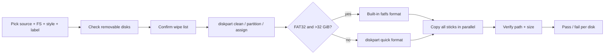

<div align="center">

# MultiUSB

### Wipe. Format. Flood. Verify. Repeat.

*Because plugging in twelve sticks and praying to robocopy is a lifestyle choice, not a strategy.*

[](https://github.com/jfmiller52/MultiUSB/releases)
[](https://github.com/jfmiller52/MultiUSB/stargazers)
[](https://www.rust-lang.org/)
[](https://www.microsoft.com/windows)
[](https://crates.io/crates/gpui-kit)

</div>

---

## What is this?

**MultiUSB** is a Windows desktop app for technicians who need the same folder on a pile of USB sticks — without accidentally redecorating the system drive.

You pick a source folder, a filesystem, a partition style, a label, and the removable disks you actually meant to nuke. MultiUSB wipes those disks with `diskpart`, formats them (FAT32 auto-picks diskpart or built-in `fatfs` when the stick is over 32 GiB — no sidecar `.exe` haunted attic), copies the folder onto every prepared stick **at the same time**, then verifies every file’s path and size. One stick fails? The others keep going. Your blood pressure stays mostly theoretical.

## Features

| Feature | Why you’ll care |
|--------|------------------|
| **Disk-first UI** | Settings strip up top, removable disks as the main stage, live log beside them |
| **Per-disk + batch progress** | Watch each stick crawl toward glory (or doom) |
| **FAT32 / NTFS / exFAT** | FAT32 >32 GiB uses built-in `fatfs` — no `fat32format.exe` |
| **MBR or GPT** | Because some firmware still lives in 2009 |
| **Concurrent copy** | Sticks don’t take turns like polite dinner guests |
| **Path + size verify** | “Robocopy exit code 7” is not a verification strategy |
| **Serials in UI & logs** | Spot the guilty stick later without psychic powers |
| **Admin relaunch** | `diskpart` doesn’t do “pretty please” |
| **No console flash** | PowerShell and diskpart stay backstage |

## How a batch runs



## Quick Start

### Option A — just run it (recommended)

1. Grab the latest build from [Releases](https://github.com/jfmiller52/MultiUSB/releases) (`MultiUSB-0.3.0.exe` or newer).
2. Right-click → **Run as administrator** (or let the app relaunch elevated for you).
3. Browse to your source folder, pick filesystem / partition style / label, check the sticks, hit **Start**, read the confirmation like it’s a nuclear launch checklist, then go make coffee while progress bars do cardio.

> **Warning:** MultiUSB *cleans the entire selected disk*. Removable only, nothing checked by default, confirmation required — still: don’t check the stick you meant to keep vacation photos on. Computers are obedient. Computers are not wise.

### Option B — build from source

```powershell
# Needs Rust + MSVC Build Tools (link.exe must exist)
git clone https://github.com/jfmiller52/MultiUSB.git
cd MultiUSB
cargo build --release --bin MultiUSB
.\target\release\MultiUSB.exe
```

Run elevated for wipe/format. Unit tests never touch real disks:

```powershell
cargo test
```

## Filesystems at a glance

| Choice | Label limit | Notes |
|--------|-------------|--------|
| **FAT32** | 11 | ≤32 GiB: `diskpart` quick format. Larger: assign-only `diskpart`, then in-process MIT [`fatfs`](https://crates.io/crates/fatfs) |
| **exFAT** | 15 | Big files, fewer existential crises |
| **NTFS** | 32 | When the stick needs to grow up |

Partition styles: **MBR** or **GPT**. Nothing is pre-selected on launch — MultiUSB refuses to guess your life choices.

## Project Structure

```
MultiUSB/
├── docs/
│   └── superpowers/
│       ├── plans/          # Implementation plans
│       └── specs/          # Design specs
├── src/
│   ├── app.rs              # GPUI Kit window, disk-first layout, live log
│   ├── commands.rs         # Retries, inventory JSON parsing
│   ├── copy.rs             # Concurrent tree copy (no robocopy)
│   ├── disk_id.rs          # Removable identity, rematch, system-disk gate
│   ├── format_plan.rs      # diskpart scripts + auto FAT32 size routing
│   ├── job.rs              # Prepare → copy → verify orchestration
│   ├── label.rs            # Filesystem / partition enums + label rules
│   ├── log_file.rs         # Run logs under Logs/
│   ├── session.rs          # UI models, progress, serial naming
│   ├── source.rs           # Source walk (no junction/symlink escape)
│   ├── verify.rs           # Path + size verification
│   ├── windows_host.rs     # WMI, diskpart, elevation, built-in FAT32 >32 GiB
│   ├── lib.rs
│   └── main.rs             # windows_subsystem = "windows"
├── Cargo.lock
├── Cargo.toml
└── README.md
```

## Documentation

| Resource | Description |
|----------|-------------|
| [GUI design](docs/superpowers/specs/2026-11-09-multiusb-gui-design.md) | Goals, wipe/copy/verify behavior, safety rules |
| [Disk-first layout](docs/superpowers/specs/2026-11-10-disk-first-layout-design.md) | Settings strip, dual progress, live log, serials |
| [Built-in FAT32 >32 GiB](docs/superpowers/specs/2026-11-10-built-in-large-fat32-design.md) | Why `fat32format.exe` got fired |
| [Releases](https://github.com/jfmiller52/MultiUSB/releases) | Prebuilt `.exe` downloads |

## Safety (the boring part that saves careers)

- Only disks Windows reports as **Removable Media** appear.
- Nothing is checked until you check it.
- **Start** opens a confirmation that names the disks; that confirm button is the only wipe trigger.
- If a selected disk turns out to hold a Windows system volume, the batch **stops** — already-cleaned sticks are called out in the message.
- Labels are sanitized before they enter a `diskpart` script.
- Junctions / symlinks in the source tree are **not** followed out into the rest of your filesystem.
- No content hashing (yet). Verification is path + size — picky about attendance, chill about bitwise soul-searching.

## Contributing

Found a bug? Want a feature that isn’t “please wipe my C: drive faster”? Open an issue or PR. Keep changes on `main`, keep tests honest, and never land code that formats a disk in a unit test (we have standards, even if the sticks don’t).

<a href="https://github.com/jfmiller52/MultiUSB/graphs/contributors">
  
</a>

## License

No license file is published in this repository yet. Treat it as private tooling unless the owner says otherwise.

---

<div align="center">

*Made for people who have wiped the wrong USB once and sworn never again.*

**[Download latest release](https://github.com/jfmiller52/MultiUSB/releases/latest)** · **[Report an issue](https://github.com/jfmiller52/MultiUSB/issues)**

</div>
